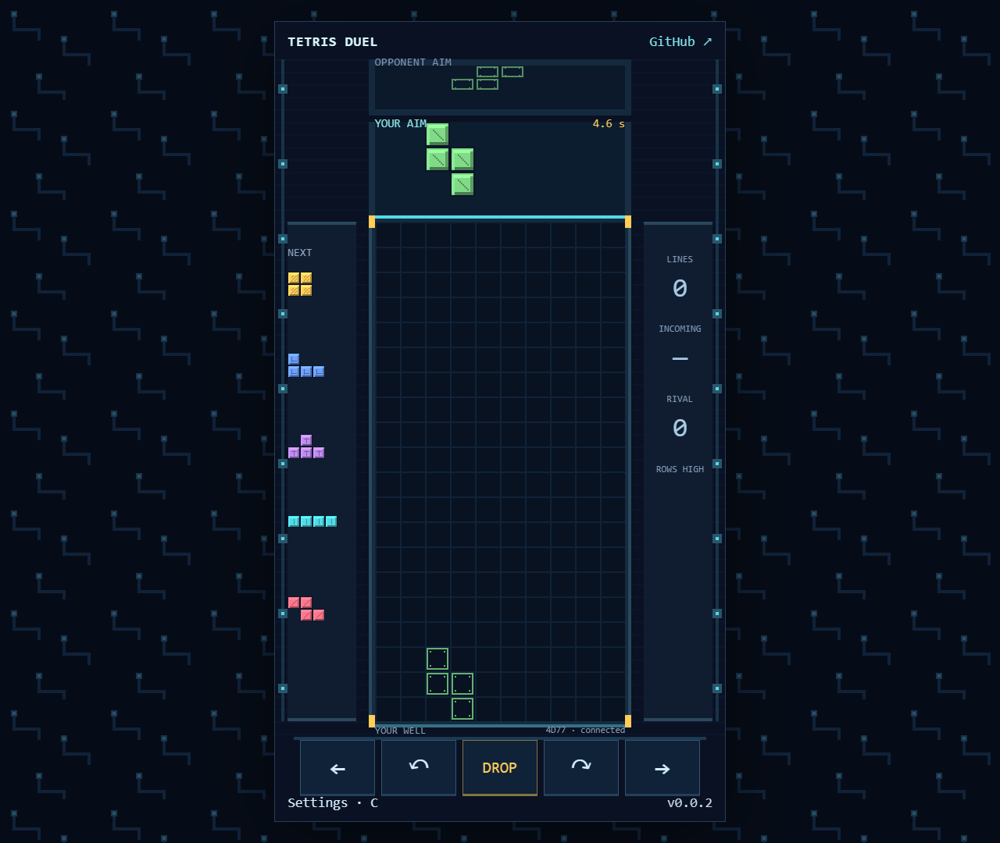

<a href="docs/samuel-asher-rivello-banner.png"></a>

# Tetris Multiplayer Clone

A private-board, two-player pixel-art duel: aim above the well, release, and send pressure with line clears.

## Live Demo

- [Play Tetris Multiplayer Clone](https://samuelasherrivello.github.io/babylon-lite-tetris-multiplayer-clone/)

## Images

<a href="docs/verification/public-duel.png"></a>

## Getting Started

Use Node.js 24 and a browser with hardware-accelerated WebGPU, such as current Microsoft Edge or Chrome on a supported device.

```sh
npm ci
npm run dev
npm test
npm run build
npm run preview
```

Run commands from the repository root. Vite prints the local URL; the app uses `/babylon-lite-tetris-multiplayer-clone/`. Source and tests live in `tetris/`, output in `tetris/dist/`. A useful error appears if WebGPU is unavailable; no fallback renderer is included.

Create an editable four-character room and send its share link to a friend. Your friend joins, then both choose **Ready up**. A third player cannot join. The three-second countdown starts the duel. Both must agree to a rematch.

## Controls

| Action | Keyboard | Touch / pointer |
| --- | --- | --- |
| Move aim | Left / Right, A / D | Left / Right buttons |
| Rotate clockwise | Up / X | Clockwise button |
| Rotate counterclockwise | Z | Counterclockwise button |
| Release piece | Space | DROP |
| Settings | C / B | Settings |
| Fullscreen | F | Settings checkbox |
| Cycle render resolution | R | Settings selector |

Movement repeats after 150 ms, then every 50 ms. Touch controls support concurrent pointers. Losing focus or opening settings releases held inputs. **The online match continues while settings are open.**

## Rules

- Exactly two human opponents. You see only your own 10×20 well, your next five pieces, and your landing ghost. Four hidden rows are used for entry and top-out.
- Your opponent shares a compact aiming outline above your well and a line showing their highest settled row. Their board, falling pieces, queue, landing and garbage gaps remain private at the server projection boundary.
- Aim and rotate above the board. Release manually or automatically after five seconds. Descent takes 200 ms and cannot be steered. Your next piece arrives after settlement, independently of your rival.
- Both receive identical independent seven-bags. Rotations try horizontal kicks 0, −1, +1, −2, +2. There is no hold, soft drop, continuous gravity, floor kick, spin or combo bonus.
- Clearing one / two / three / four rows attacks with zero / one / two / four garbage rows. Your attack first cancels incoming rows in FIFO order. Opposing attacks on the same simulation tick cancel each other.
- Incoming rows warn for at least one second. Mature rows enter only after your next placement and its cancellation, never during descent. Each packet uses one hidden gap column.
- Blocked entry, hidden-row top-out or garbage overflow ends your round. The survivor wins; simultaneous top-out on the same 20 ms tick is a draw.

## Multiplayer and recovery

Uses the existing [RMC Colyseus Multiplayer Server](https://github.com/SamuelAsherRivello/rmc-colyseus-multiplayer-server), its WebSocket relay, and **free Vercel Hobby**. The static client is hosted on GitHub Pages. The browser contains no deployment credentials.

The authoritative server validates every command, advances deadlines, resolves clears/attacks and decides results. Local aiming and release are predicted, then reconciled using acknowledged sequences and piece/epoch IDs. Opponent hints use monotonic recipient snapshots; there is no hidden opponent simulation on the client.

Pinned client release: [v0.9.12](https://github.com/SamuelAsherRivello/rmc-colyseus-multiplayer-server/releases/tag/v0.9.12), installed from its exact release tarball and lockfile. Public relay: `https://rmc-colyseus-multiplayer-server.vercel.app`. For a local backend, copy `.env.example` to `.env.local` and set `VITE_MULTIPLAYER_SERVER_URL`, then restart Vite.

Refresh recovery uses a rotating seat credential in **sessionStorage**, never the share URL. After the server detects a disconnect, both clocks pause; each seat has a cumulative 15-second recovery budget per match. Explicit **Leave / new room** forfeits. Each free Vercel relay request is bounded (up to 300 seconds), and rooms are process-local. Expired or lost rooms require a new code; cross-instance durable recovery is not promised.

## Presentation and verification

Babylon Lite 1.32.0 renders a stationary 288×512 logical surface with 16-pixel cells. Integer CSS scaling is used whenever 1× fits. Smaller displays use fractional fit; fractional DPR and reduced render presets have reduced pixel-spacing guarantees. DPR is applied once to the native backing size. Nearest sampling, no texture mipmaps and one MSAA sample preserve hard edges.

Original patterned blocks, circuit gutters and six short event sounds are reproducible with `python tools/generate-game-assets.py --output tetris/src/content/assets`. Mute in Settings or append `?mute=1` (combine with room links using `&mute=1`). Reduced effects disables cosmetic flashes. No music.

See [verification evidence](docs/verification/README.md), [asset provenance](docs/asset-provenance.md), [game brief](docs/game-brief.md), [template adaptations](docs/template-adaptations.md) and [backend release evidence](docs/backend-release-verified.json). Physical touch hardware and Codex skill autocomplete are unverified; browser touch emulation is recorded separately.

## Release

Latest verified release: [v0.0.2](https://github.com/SamuelAsherRivello/babylon-lite-tetris-multiplayer-clone/releases/tag/v0.0.2).

The checked-in **Release** GitHub Actions workflow tests/builds, bumps root `version.txt`, commits/tags on `main`, and creates a GitHub release. **Deploy live demo** builds and deploys Pages on pushes to `main` or manual dispatch. Explicitly dispatch Pages after a release bot commit when needed, then verify `/version.txt` and the displayed version. No paid backend or alternate host is needed.

## Credits

Built from [GitHub Repository Template](https://github.com/SamuelAsherRivello/github-repository-template) with [AI Skills Library](https://github.com/SamuelAsherRivello/ai-skills-library), React, Vite and [Babylon Lite](https://www.npmjs.com/package/@babylonjs/lite). [Tetris](https://en.wikipedia.org/wiki/Tetris) supplies gameplay inspiration; all project art, effects and sounds are original. This independent project is not affiliated with or endorsed by the Tetris rights holders.

## Original AI Prompt

[{original-ai-prompt-url}]({original-ai-prompt-url}) — source URL unavailable; prompt-link provenance remains unverified. The initiating text and consequential follow-ups are preserved below; the interpreted game brief is separate.

<details>
<summary>Initiating request and supplied template</summary>

```text
update this template and fully populate it for a multiplayer 2d pixel perfect game of [https://en.wikipedia.org/wiki/Tetris](https://en.wikipedia.org/wiki/Tetris)

$ai-skills-create-game

- Title: [Enter the Gungeon Clone]
- Type: [Multiplayer, online cooperative, 2–4 players. All human players cooperate on the same team.]
- World and camera:
  - [Create one 2D level approximately twice the viewport width and twice its height, giving it about four times the area of one screen.]
  - [The level may be tile-based or use freely placed artwork and geometry.]
  - [Use a top-down orthographic camera that smoothly follows the local player and stays within the level boundaries.]
- Core loop: [Cooperate to survive increasingly difficult enemy waves, dodge bullet patterns, collect loot, and choose weapon upgrades between waves. Defeat a boss every five waves. The run ends when the entire team is down.]
- Controls: [WASD movement, mouse aiming, left-click shooting, and Space to dodge roll with a short cooldown and brief invulnerability.]
- Cooperative mechanics:
  - [Create or join a room using a shareable room code, then ready up together.]
  - [Revive downed teammates, share upgrade rewards, and disable friendly fire.]
  - [Scale enemy counts and difficulty with the number of active players.]
  - [Show directional indicators for teammates outside the local camera view.]
- Look and feel:
  - [Original pixel-art dungeon scenery with stone floors, destructible props, and readable cover.]
  - [Distinct player colors, expressive enemies, bright projectiles, punchy muzzle flashes, and clear hit feedback.]
  - [Keep enemy bullets visually distinct from friendly shots. Show player health, teammate status, current wave, remaining enemies, and dodge cooldown.]
- Gameplay requirements:
  - [Include three starting weapons with distinct firing patterns and meaningful upgrades.]
  - [Include enemies that chase, fire aimed shots, and emit radial bullet patterns.]
  - [Provide short breaks between waves for upgrades and a team restart option after defeat.]
- Multiplayer server and smoothness:
  - [Use https://github.com/SamuelAsherRivello/rmc-colyseus-multiplayer-server or my writable fork: <fork URL, if applicable>.]
  - [Automatically update the selected server repository with the room logic and synchronized state required by this game.]
  - [Make the server authoritative for movement validation, combat, enemy spawning, damage, loot, revives, and wave progression.]
  - [Use supported Colyseus prediction features where available, or implement suitable client-side prediction, server reconciliation, and interpolation.]
  - [Respond immediately to local movement and dodge inputs. Smooth reconciliation corrections and drive the camera from the predicted local character position to avoid visible jitter.]
  - [Interpolate remote players and enemies. Use immediate local animations, muzzle flashes, and cosmetic effects while reconciling gameplay outcomes with the server.]
  - [Use deterministic projectile motion or other bandwidth-efficient synchronization where appropriate.]
  - [Prioritize a smooth, consistent experience for every player over action density. If synchronization struggles, reduce concurrent bullets, enemies, spawn rates, and firing rates.]
  - [Handle disconnects and reconnects gracefully.]
  - [Verify with at least two browser clients, including simulated latency and jitter. Check responsive local movement, stable camera tracking, smooth remote motion, and consistent combat outcomes.]
- Inspiration links:
  - [https://store.steampowered.com/app/311690/Enter_the_Gungeon/]
- Inspiration screenshots: [Attach reference screenshots here.]
- Originality requirement: [Keep the requested project title, but create original artwork, sounds, characters, weapons, UI, and level layouts; use the reference only for gameplay and visual inspiration.]
```

</details>

<details>
<summary>Consequential follow-up instructions</summary>

```text
1 Yeah, I see only my board, but I see maybe a line indicating the very highest of theirs, and I see an outline of their next piece at the top as they're moving it left and right. But once they release it, I don't see it falling, and I don't see their blocks.

stop there.

Now read the [$ai-skills-create-game](C:\Users\srive\\.agents\skills\ai-skills-create-game\SKILL.md) skill and prepare a [$openspec-propose](C:\Users\srive\\.agents\skills\openspec-propose\SKILL.md) about how you will use the template and multiplayer server to meet the needs of the requested prompt. This allows for propose to think more heavily before implemtation.

it is a requirement to use the existing multiplayer server, with relay, with free vercel.

You have [$github](app://connector_76869538009648d5b282a4bb21c3d157) access and the multiplayer server has the vercel credentials. there is no reason to stop for any reason until the game is done, and shipped to the readme as a live demo.

you are required to use the free plan of vercel. stop asking for alternatives
```

</details>

The interview's numbered choices were reconciled into the approved OpenSpec design: competitive 1v1, independent placement speed, a five-second maximum aim window, one-second garbage warning with placement-boundary insertion after cancellation, and a local landing ghost. This paragraph is an interpretation of those selections, not a verbatim user quotation.

The original chat share URL is unavailable and its provenance remains unverified. No model or elapsed-time metadata is inferred.

<details>
<summary>Browser workflow follow-up</summary>

```text
when you spawn browser game windows, can you do it minimized or headless and still continue your work? that will be less disruptive to me
```

</details>
