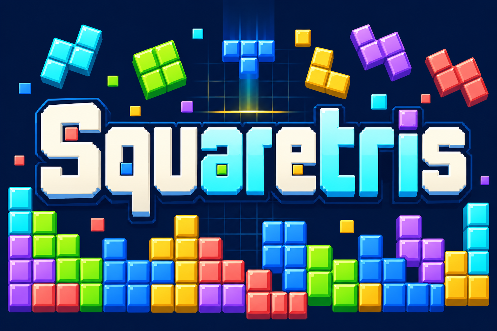

# Squaretris branding



Official name: **Squaretris**.

## Art direction

Large ivory and cyan geometric lettering, colored square pieces and a faint navy grid reflect the game's aim-and-release puzzle duel.

The existing docs/verification/duel-aim.png gameplay capture and tetris/src/content/DuelCanvas.jsx establish the navy playfield, square pieces and golden release line. The screenshot was viewed for visual context only. The final image was generated from a text prompt without supplying, cropping, tracing or compositing a screenshot.

## Asset and usage

- File: `docs/images/game-logo.png`.
- Purpose: README splash illustration and game-directory thumbnail.
- Generation: built-in OpenAI image generation through the existing Codex session. No API key, separately billed API or external image service was used.
- Format: opaque PNG, 1536 by 1024 pixels.
- Keep the complete title visible when displaying or resizing the image. The official name excludes "Multiplayer"; multiplayer capability remains documented separately where applicable.

## Final generation prompt

```text
Use case: logo-brand. Create a completely new landscape 3:2 splash logo illustration from scratch for an original block puzzle game. Exact and only text: "Squaretris", spelled S-q-u-a-r-e-t-r-i-s. This word is the dominant centered element, huge chunky custom square geometric lettering, ivory and icy cyan fronts, navy outlines, with subtle multicolored block accents. It must be readable at a directory thumbnail width of 240px. A carefully designed cascade of beveled square tetromino-like block clusters in cyan, lime green, cornflower blue, gold, lilac and coral surrounds the lettering and stacks below it; a slim horizontal golden release line and faint dark-blue grid suggest the game's aim-and-release mechanic without showing a game screen. Palette and style derive from a crisp small pixel-art portrait puzzle duel with dark navy playfield and colored square pieces. Polished pixel-inspired illustration, clean geometric shapes, strong negative space behind the word. No borrowed logos or recognizable franchise typography. No HUD, no screenshot, no game UI, no other text, no watermark, never Multiplayer. Entirely original composition. Opaque navy background.
```
